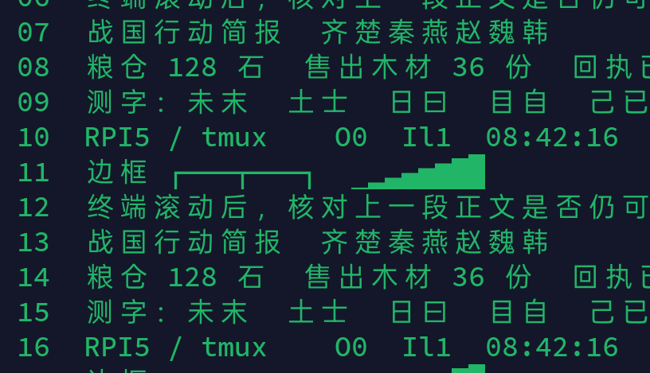
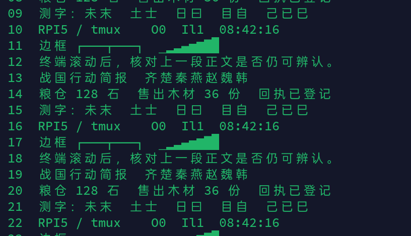
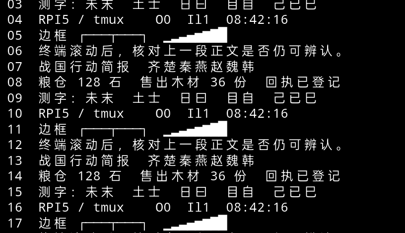
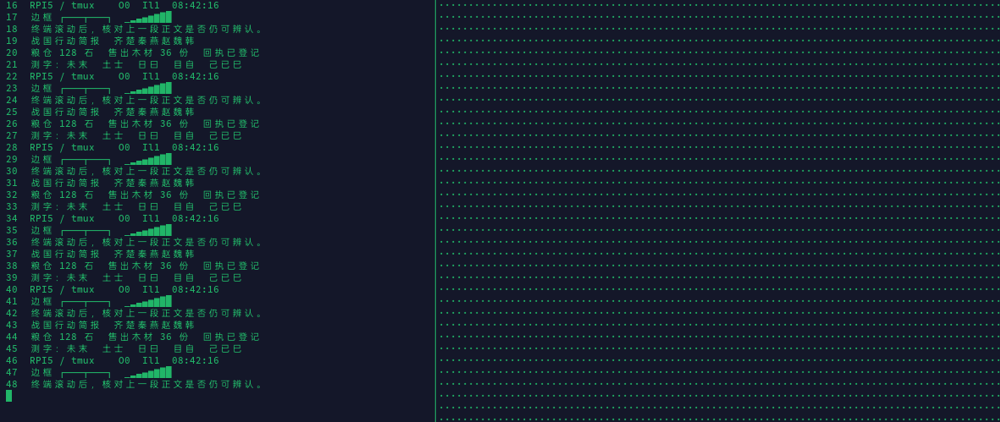
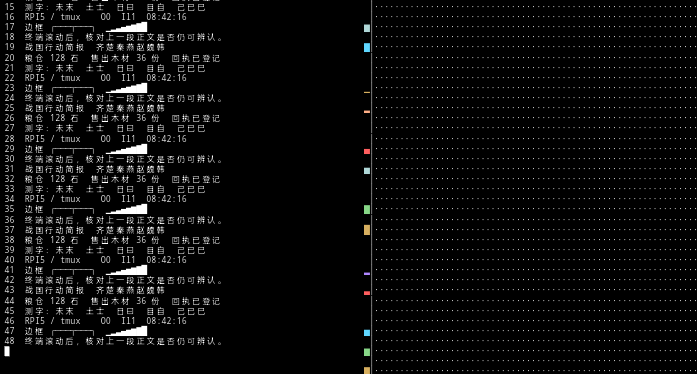

# bakaSSH 与两款现代 Android SSH 客户端

2026-11-27 · OPPO PLB110，Android 17 · rpi5，tmux 3.5a

Termius 面向需要保存主机、管理凭据和跨设备工作的用户，本轮选择本地模式。Termigo 将 tmux 会话选择、断线续接与手势翻历史作为卖点，和 bakaSSH 的移动 TUI 场景更贴近。两者均由 Google Play 安装，实测版本分别为 8.0.2 和 1.3.0。[Termius 商店页](https://play.google.com/store/apps/details?id=com.server.auditor.ssh.client) · [Termigo 商店页](https://play.google.com/store/apps/details?id=pt.rmb.termigo)

实测结论：209×193 下，Termius 在战国、Claude 和 Codex 三个真实场景均观测到历史正文移动，终端图层分别呈现 85.55、87.26、88.93 FPS。它是值得继续与 bakaSSH 对照的流畅度标杆。Termigo 的本地画面更新和远端滚动分别验证，具体模式见下表。

## 先看阅读字号

Termius 从用户交接时的主题和字号开始。软键盘收起后为 57×51，同一段没有指定前景色的测试文本呈绿色，底色偏深蓝。Termigo 的相同文本呈浅灰，底色近黑。图中含“未末、土士、日曰、目自”，也含 ASCII、箱线和块字符，便于在手机上直接辨认。配色偏好和数据吞吐分别评价。

同一屏宽从约 80 列变成 209 列，每列可分到的横向空间约为原来的 38%。209 列用于查找性能边界。日常字号使用物理屏 1256×2760，Termigo 通过应用捏合达到 77 列，Termius 保留应用字号并将 Android 显示密度从 560 临时调为 400，达到 81 列。Termius 原配色和原显示设置另留一张。

Termius · 原设置 · 57×51，终端区域原像素裁切。

Termius · 阅读样张 · 81×73，终端区域原像素裁切。

Termigo · 阅读样张 · 77×70，终端区域原像素裁切。

Termius · 209×193，终端区域原像素裁切。

Termigo · 209×193，终端区域原像素裁切。

## 滚动表现

| 客户端 | 实际 PTY | 场景 | 已证实历史移动时的呈现 FPS | 远端证据 |
| --- | --- | --- | --- | --- |
| bakaSSH 0.4.8 | 209×193 | 固定历史 | 58.87 | tmux 0–300 行 |
| bakaSSH 0.4.8 | 209×193 | 战国现场 | 58.69 | tmux 0–255 行 |
| bakaSSH 0.4.8 | 209×193 | Claude 长会话 | 56.01 | 37 次正文位移 |
| bakaSSH 0.4.8 | 209×193 | Codex 长会话 | 61.59 | 48 次正文位移 |
| Termius 8.0.2 | 209×193 | 固定历史 | 80.07 | tmux 0–300 行 |
| Termius 8.0.2 | 209×193 | 战国现场 | 85.55 | tmux 0–160 行 |
| Termius 8.0.2 | 209×193 | Claude 长会话 | 87.26 | 53 次正文位移 |
| Termius 8.0.2 | 209×193 | Codex 长会话 | 88.93 | 62 次正文位移 |
| Termius 8.0.2 | 81×73 | 阅读字号 · 固定历史 | 81.95 | tmux 85–295 行 |
| Termigo 1.3.0 · 菜单切换后 | 209×193 | 固定历史 | 未证实 | tmux 300–300 行 |
| Termigo 1.3.0 · 菜单切换后 | 209×193 | 战国现场 | 未证实 | tmux 0–0 行 |
| Termigo 1.3.0 · 菜单切换后 | 209×193 | Claude 长会话 | 未证实 | 0 次正文位移 |
| Termigo 1.3.0 · 菜单切换后 | 209×193 | Codex 长会话 | 未证实 | 0 次正文位移 |
| Termigo 1.3.0 · 菜单切换后 | 77×70 | 阅读字号 · 固定历史 | 未证实 | tmux 300–300 行 |
| Termigo 1.3.0 · 会话选择器 | 209×193 | 战国现场 | 未证实 | tmux 0–0 行 |
| Termigo 1.3.0 · 选择器再切换 vscroll | 209×193 | 战国现场 | 未证实 | tmux 0–0 行 |

四种压力场景复用同一套脚本、rpi5 上的同一对长会话来源和相同手势。真实战国的内容与网络情况随时间变化。固定历史内容区为 200×160，阅读组固定历史为 76×60，三轮共九次滑动。尺寸取远端实际 PTY。Termigo 初批使用直接附着的测试入口，原生入口另用其菜单 TMUX Sessions 选择 zg-mixed，再点 Just this time 确认。各应用逻辑像素、字体和滑动到行数的映射仍有差异。bakaSSH 复用同日基线，按用户要求关闭全部连接，没有新采阅读字号样张。

## 终端协议与固定输出

| 客户端 | 光标回报检查 | 32 行滚动 P50 ms | 160 行重写 P50 ms | 状态 |
| --- | --- | --- | --- | --- |
| bakaSSH | 5/5 | 75.2 | 74.5 | 完成 |
| Termius | 5/5 | 64.4 | 73.9 | 完成 |
| Termigo | 0/5 | 未完成 | 未完成 | ('unexpected final cursor position', [0, 0]) |

直接 SSH 查询覆盖绝对定位、汉字宽度、组合字符、光标保存恢复和局部滚动区。Termigo 对第 7 行第 11 列回报第 6 行第 10 列，期望 [1,1] 的帧末查询回报 [0,0]，所以没有可比吞吐耗时。该结果描述协议应答，无法单凭它判断屏幕上汉字是否画对。

## 交互与计量边界

Termigo 在配置页提供 Attach to a tmux session，终端菜单里还有 TMUX Sessions、TMUX vscroll mode。对只想往回读几行的人，寻找入口和辨认当前模式都增加了操作。普通 SSH 的测试与切换菜单后的测试分别存档；应用本地回看不一定会改变远端历史。只计到绘制活动时，表格保留“未证实”。

bakaSSH 使用 Perfetto FrameTimeline 有效呈现时间。Termius 和 Termigo 均使用独立 SurfaceView，FrameTimeline 在输入区间覆盖不足；两款竞品统一读取终端 BLAST 图层的 SurfaceFlinger 实际呈现时点，经时钟快照转换后按同一组设备端手势时间统计。两种采集方法有差异。远端 tmux 位置变化、或至少三条唯一正文行一起位移，作为真滚动的独立证据。

| 客户端 | 场景 | PTY | 呈现帧 | 采样秒 | 图层 FPS | 帧间 P95 ms | 数据源 |
| --- | --- | --- | --- | --- | --- | --- | --- |
| bakaSSH 0.4.8 | 固定历史 | 209×193 | 412 | 7.0 | 58.87 | 36.005 | FrameTimeline |
| bakaSSH 0.4.8 | 战国现场 | 209×193 | 416 | 7.09 | 58.69 | 32.217 | FrameTimeline |
| bakaSSH 0.4.8 | Claude 长会话 | 209×193 | 403 | 7.2 | 56.01 | 36.387 | FrameTimeline |
| bakaSSH 0.4.8 | Codex 长会话 | 209×193 | 436 | 7.08 | 61.59 | 27.844 | FrameTimeline |
| Termius 8.0.2 | 固定历史 | 209×193 | 558 | 6.9685 | 80.07 | — | SurfaceFlinger BLAST |
| Termius 8.0.2 | 战国现场 | 209×193 | 596 | 6.9665 | 85.55 | — | SurfaceFlinger BLAST |
| Termius 8.0.2 | Claude 长会话 | 209×193 | 612 | 7.0132 | 87.26 | — | SurfaceFlinger BLAST |
| Termius 8.0.2 | Codex 长会话 | 209×193 | 626 | 7.0392 | 88.93 | — | SurfaceFlinger BLAST |
| Termius 8.0.2 | 阅读字号 · 固定历史 | 81×73 | 581 | 7.0895 | 81.95 | — | SurfaceFlinger BLAST |
| Termigo 1.3.0 · 菜单切换后 | 固定历史 | 209×193 | 167 | 6.7677 | 24.68 | — | SurfaceFlinger BLAST |
| Termigo 1.3.0 · 菜单切换后 | 战国现场 | 209×193 | 535 | 6.8334 | 78.29 | — | SurfaceFlinger BLAST |
| Termigo 1.3.0 · 菜单切换后 | Claude 长会话 | 209×193 | 299 | 6.7927 | 44.02 | — | SurfaceFlinger BLAST |
| Termigo 1.3.0 · 菜单切换后 | Codex 长会话 | 209×193 | 266 | 6.8294 | 38.95 | — | SurfaceFlinger BLAST |
| Termigo 1.3.0 · 菜单切换后 | 阅读字号 · 固定历史 | 77×70 | 542 | 7.0836 | 76.51 | — | SurfaceFlinger BLAST |
| Termigo 1.3.0 · 会话选择器 | 战国现场 | 209×193 | 536 | 6.8521 | 78.22 | — | SurfaceFlinger BLAST |
| Termigo 1.3.0 · 选择器再切换 vscroll | 战国现场 | 209×193 | 531 | 6.8527 | 77.49 | — | SurfaceFlinger BLAST |
